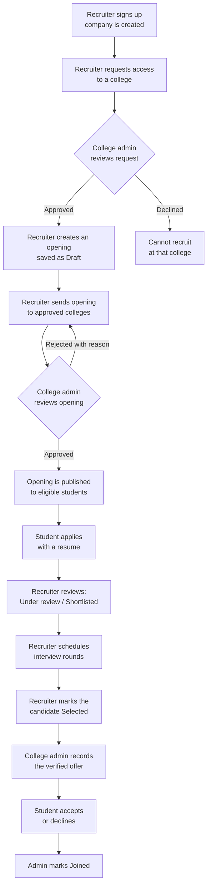

# CampusConnect User Manual

CampusConnect is a campus placement platform that connects three groups in one system:

- **Students** build a career profile, find jobs and internships shared with their college, apply, attend interviews, and respond to offers.
- **Recruiters** represent companies. They ask colleges for permission to recruit, publish openings, review applicants, and run interview rounds.
- **College administrators** (placement officers) approve companies and openings, verify student documents, set placement rules, run placement drives, record offers, and monitor outcomes.

Live demo: **https://campusconnectapp.pythonanywhere.com**

---

## Contents

1. [Key ideas](#1-key-ideas)
2. [How a placement moves through the system](#2-how-a-placement-moves-through-the-system)
3. [Accounts and signing in](#3-accounts-and-signing-in)
4. [Student guide](#4-student-guide)
5. [Recruiter guide](#5-recruiter-guide)
6. [College administrator guide](#6-college-administrator-guide)
7. [Notifications and email preferences](#7-notifications-and-email-preferences)
8. [Platform setup (system administrators)](#8-platform-setup-system-administrators)
9. [Reference: statuses, choices, and limits](#9-reference-statuses-choices-and-limits)
10. [Frequently asked questions](#10-frequently-asked-questions)
11. [Known limitations](#11-known-limitations)
12. [Glossary](#12-glossary)

---

## 1. Key ideas

These principles explain most of the platform's behavior.

**Each college controls its own data.** A college administrator only ever sees the students, applications, interviews, documents, and companies connected to their own college. Two colleges using CampusConnect never see each other's data.

**Companies must be approved by each college separately.** Signing up as a recruiter creates a company, but that company cannot recruit anywhere until a college approves its recruitment request. Approval at one college says nothing about another.

**Every opening is approved per college.** A recruiter sends an opening to one or more approved colleges. Each college reviews it independently. Students only see an opening after their own college approves it.

**The server makes every decision.** Eligibility, permissions, deadlines, and status changes are checked by the server, not just hidden in the interface. A student who is not eligible cannot apply, even by bypassing the page.

**Students control their visibility.** A student can turn off recruiter discovery. Only recruiters from companies approved by the student's college can ever find a student's profile.

**Every important change is recorded.** Application status changes keep a full timeline, and college administrators have an audit log of all changes made within their college.

---

## 2. How a placement moves through the system

A typical journey, step by step:

1. A **recruiter** signs up, which creates their company. They then send a recruitment request to a college.
2. The **college administrator** approves the request. The company can now recruit at that college.
3. The **recruiter** creates an opening (job or internship) with eligibility rules and sends it to the college.
4. The **college administrator** approves the opening. It is published to that college's students.
5. A **student** who meets the eligibility rules and the college's placement policy applies, choosing one of their resumes.
6. The **recruiter** moves the application forward: under review, shortlisted, interviews, then selected or rejected. The student is notified at each step.
7. The **college administrator** records the offer for a selected student, including the annual package.
8. The **student** accepts or declines the offer. The administrator can later mark the student as joined.

---

## 3. Accounts and signing in

### 3.1 The three portals

| Portal | Sign in | Create an account |
|---|---|---|
| Student | `/student/login` | `/student/signup` |
| Recruiter | `/recruiter/login` | `/recruiter/signup` |
| College admin | `/admin-login` | Not available publicly (see [3.4](#34-college-administrator-accounts)) |

The home page (`/`) has a **Choose your workspace** section with a card for each portal.

Each portal only accepts its own kind of account. Signing in to the wrong portal with valid details shows **"This account is not authorized for the selected portal."**

### 3.2 Student sign-up

Open `/student/signup` and fill in:

| Field | Rules |
|---|---|
| First name, Last name | Required |
| College | Required. Lists every active college. |
| Degree and branch | Required. Lists the active programs of the selected college. Available after choosing a college. |
| Enrollment number | Required. 3–40 letters, numbers, slashes, underscores, or hyphens. Must be unique within the college. Stored in uppercase. |
| Graduation year | Required. Four digits between 2000 and 2100. |
| Email address | Required. Must not already be registered. |
| Password, Confirm password | Required. At least 8 characters, not too similar to your name or email, not a common password, and not entirely numbers. |

After signing up, you can sign in immediately. No email confirmation is needed.

Your college, program, enrollment number, and graduation year are your **identity fields**. You cannot change them yourself later, so check them carefully.

If the page says **"No active college is configured yet"**, the platform has not been set up. See [section 8](#8-platform-setup-system-administrators).

### 3.3 Recruiter sign-up

Open `/recruiter/signup` and fill in:

| Field | Rules |
|---|---|
| First name, Last name | Required |
| Company name | Required, up to 200 characters. Must not already be registered. |
| Industry | Required |
| Your designation | Required, for example "Talent Acquisition Lead" |
| Company website | Required. `https://` is added if you leave it out. |
| Company contact email | Required |
| Your phone | Optional |
| Email address, Password, Confirm password | Same rules as student sign-up |

Signing up creates **your account, your company, and makes you the company owner**. Only the owner can edit company details.

If your company is already registered, sign-up is refused with **"This company is already registered. Ask its owner or the college administrator to add you."**

### 3.4 College administrator accounts

There is no public sign-up for administrators. A system administrator creates them through the Django admin panel. See [section 8](#8-platform-setup-system-administrators).

### 3.5 Signing in

Enter your email and password and select **Sign in**. You land on your dashboard, or on the page you were trying to open before signing in.

| Message | Meaning |
|---|---|
| Invalid email or password. | Wrong details, a suspended account, or a student account that has not been activated yet |
| This account is not authorized for the selected portal. | Correct details, but for a different portal |
| This administrator account is not active. | Administrator account missing staff access. Ask a system administrator. |

You stay signed in for up to 7 days, even after closing the browser. Select **Sign out** on your dashboard to end the session.

### 3.6 Forgotten password

1. On any sign-in page, select **Forgot password?**
2. Enter your registered email and select **Send reset link**.
3. Open the link in the email and choose a new password.

The page always gives the same response, whether or not the email is registered, so it cannot be used to discover accounts.

The reset link works once and expires after **1 hour**. After resetting, sign in through your portal. Other signed-in sessions are signed out.

### 3.7 Activating an account created by your college

If your college created your account in bulk, you receive an email titled **"Activate your CampusConnect student account"**.

1. Open the link in the email.
2. Choose your private password and select **Activate account**.
3. Sign in at `/student/login`.

The link expires after **1 hour**. If it has expired, ask your placement office to resend it, or use **Forgot password?** with the same email.

---

## 4. Student guide

### 4.1 Getting ready to apply: checklist

Complete these before applying. Your college may require some of them.

1. Fill in your **profile**: personal details and academic scores ([4.3](#43-profile)).
2. Add **skills, projects, and experience** to your portfolio ([4.4](#44-career-portfolio)).
3. Upload a **PDF resume** ([4.6](#46-resumes)).
4. Submit your **academic documents** for verification ([4.11](#411-academic-documents)).
5. Check **Placement readiness** to confirm nothing is blocking you ([4.10](#410-placement-readiness)).

### 4.2 Dashboard

`/student/dashboard` is your home page after signing in.

- **Profile ready:** your profile completion percentage, with an **Improve profile** link.
- **Summary cards:**

| Card | Counts |
|---|---|
| Applications | All your applications |
| In review | Applications that are Applied, Under review, or at the Interview stage |
| Shortlisted | Applications that are Shortlisted |
| Upcoming interviews | Scheduled interviews that have not happened yet |
| Selected | Applications where you were Selected |

- **Quick access tiles** to every student page.
- **Recommended for you:** up to 4 eligible openings you have not applied for, each with a match score.
- **Upcoming interviews:** your next 3 interviews.
- **Recent applications:** your latest 4 applications with their status.
- **Latest announcements:** the newest 3 notices, with a **New** badge on unread ones.
- **Notification bell** and **Sign out** in the top bar.

### 4.3 Profile

`/student/profile`. Keep this accurate, because eligibility checks use these values.

**Profile picture.** JPEG, PNG, or WebP, up to 2 MB. It is uploaded when you select **Save profile**.

**College identity** (read-only): college, program, branch, enrollment number, graduation year.

**Personal details:**

| Field | Rules |
|---|---|
| First name, Last name | Required |
| Phone | Optional. 7–15 digits with an optional leading `+`. |
| Date of birth | Optional. Must be in the past. |
| Location | Optional, up to 150 characters |
| Career objective | Optional, up to 1000 characters |

**Academic performance:**

| Field | Range |
|---|---|
| Current CGPA | 0–10 |
| 10th percentage | 0–100 |
| 12th percentage | 0–100 |
| Active backlogs | 0 or more |

**Career presence and preferences:**

| Field | Notes |
|---|---|
| LinkedIn, GitHub, Portfolio URLs | Optional, must be valid links |
| Preferred job role | Used for recommendations, for example "Backend Developer" |
| Preferred locations | Separate several with commas, for example "Bengaluru, Pune". Used for recommendations. |
| Visible to verified recruiters | On by default. See below. |

**Recruiter visibility.** When on, recruiters from companies approved by your college can find your professional profile and download your primary resume through talent discovery. When off, you are hidden from talent discovery. Companies you have applied to can still see your application.

Select **Save profile** to save all changes.

### 4.4 Career portfolio

`/student/portfolio`. Each section has an **Add** button. Every entry can be edited (pencil) or deleted (trash).

**Skills:**

| Field | Rules |
|---|---|
| Skill name | Required, 2–80 characters. Each skill only once. |
| Proficiency | Beginner, Intermediate, Advanced, or Expert |
| Years of experience | 0–50, in steps of 0.5 |

Skills matter: recruiters search by them, and recommendations compare them with each opening's required skills.

**Projects:** title (required), technologies, description (required, up to 2000 characters), GitHub URL, live URL, start date (required), end date, and **This project is ongoing**.

**Certifications:** name and issuing organization (required), credential ID, credential URL, issue date (required), expiry date.

**Experience:** organization, role, and employment type (required: Internship, Full-time, Part-time, Freelance, or Volunteer), location, responsibilities, start date (required), end date, and **I currently work here**.

End dates cannot be before start dates. Entries marked ongoing or current cannot have an end date.

### 4.5 Profile completion score

Your profile completion percentage is out of 100 and is calculated from:

| Section | Points | What earns them |
|---|---|---|
| Personal details | 20 | First name, last name, phone, date of birth, location, career objective |
| Academic performance | 20 | CGPA, 10th percentage, 12th percentage |
| Career presence | 10 | Preferred job role, and at least one professional link |
| Skills | 15 | At least 3 skills |
| Projects | 15 | At least one project |
| Resume | 10 | A primary resume |
| Experience | 5 | At least one experience entry |
| Certifications | 5 | At least one certification |

Each section earns points in proportion to how much of it is complete. The **Resumes** page shows a per-section breakdown and the next recommended item to add. Your college may require a minimum score before you can apply.

### 4.6 Resumes

`/student/resumes`. You can keep several resume versions, for example one for software roles and one for data roles.

**Upload a resume:**

1. Enter a **version title** (defaults to "Placement resume").
2. Choose a **PDF file**, up to 5 MB. The file must be a real PDF.
3. Select **Upload resume**.

**Primary resume.** Your first upload becomes the primary resume automatically. Use **Make primary** (star) to change it. The primary resume is:

- the one recruiters can download through talent discovery, and
- the one preselected when you apply.

**Managing versions:**

- **Open resume** views the file.
- **Rename** changes the title.
- **Delete** removes a version. A resume attached to an application cannot be deleted, because the recruiter must keep seeing the version you applied with. If you delete your primary resume, your most recently updated one becomes primary.

To change a resume's content, upload a new version. Files cannot be replaced in place.

### 4.7 Finding opportunities

`/student/opportunities` lists the jobs and internships available to you.

**What you can see.** An opening appears only if:

- it is published and its deadline has not passed,
- your college approved it, and
- the company is approved by your college.

**Tabs:**

- **All:** every opening available to you, with filters.
- **Recommended:** up to 12 eligible openings ranked by match score ([4.8](#48-recommendations-and-match-score)).
- **Saved:** openings you bookmarked.

**Filters (All tab):**

| Filter | What it does |
|---|---|
| Search | Matches role, company, location, or skill |
| Type | Jobs or Internships |
| Work mode | On-site, Remote, or Hybrid |
| Company | Company name contains the text |
| Required skill | Opening requires a skill containing the text |
| Minimum compensation | Opening pays at least this amount |
| Deadline before | Deadline is on or before the date |
| Eligibility | All results, or Eligible only |
| Sort by | Newest, Deadline soon, or Highest compensation |

Select **Apply filters** to apply them and **Clear** to reset.

**Each opening card shows:** company, title, location, work mode, description, openings, minimum CGPA, deadline, and required skills. Skills you already have are highlighted. An **Eligible** or **Not eligible** badge appears on each card.

**Eligibility.** If you are not eligible, the card lists every reason, for example:

- Minimum CGPA required: 7.5.
- Maximum active backlogs allowed: 0.
- Graduation year must be 2026 or later.
- Your academic program is not eligible for this opportunity.
- Any unmet college placement requirement ([4.10](#410-placement-readiness)).

If you have not entered a CGPA, openings with a minimum CGPA count you as not eligible. Skills never affect eligibility, only the match score.

**Saving.** Select the bookmark icon to save an opening. Saved openings are private to you.

### 4.8 Recommendations and match score

The **Recommended** tab and the dashboard rank eligible openings by a match score from 0 to 100:

| Factor | Points |
|---|---|
| Required skills you have | Up to 50, in proportion to how many you match. Openings with no required skills get 25. |
| Opening title shares a word with your preferred job role | 20 |
| Remote work, or a location matching one of your preferred locations | 15 |
| Opening specifically targets your program | 10. Openings open to all programs get 5. |
| Compensation details are given | 5 |

The reasons are shown under each recommendation, for example "Matches 3 of 4 required skills" or "Remote work option". To improve recommendations, add skills and fill in your preferred job role and locations.

Recommendations are empty while any college placement requirement is unmet.

### 4.9 Applying and tracking applications

**To apply:**

1. On an opening you are eligible for, select **Apply now**.
2. Choose the **resume** to attach. Your primary resume is preselected.
3. Optionally add a **cover letter** (up to 3000 characters).
4. Select **Submit application**.

You need at least one uploaded resume. The application is refused if:

- you have already applied for this opening,
- the opening is closed or its deadline has passed,
- the opening was not shared with your college, or its company is no longer approved by your college,
- you do not meet the eligibility rules or your college's placement policy.

**Tracking applications** at `/student/applications`. Each application shows the company, title, date applied, the attached resume, your cover letter, and a **timeline** of every status change with any note from the recruiter.

| Status | Meaning |
|---|---|
| Applied | You submitted the application |
| Under review | The recruiter is reviewing it |
| Shortlisted | You passed initial screening |
| Interview stage | You have been scheduled for an interview |
| Selected | The company selected you. An offer will follow from your college. |
| Rejected | The application was not successful |
| Withdrawn | You withdrew the application |

You are notified whenever the status changes.

**Withdrawing.** While an application is Applied, Under review, or Shortlisted, select **Withdraw application** and confirm. Withdrawal is permanent: you cannot apply to the same opening again. Once interviews have started, you can no longer withdraw.

### 4.10 Placement readiness

`/student/readiness` shows whether your college's placement policy allows you to apply, and what to fix if not.

- **Ready to apply:** you meet the college-wide rules.
- **Action needed before applying:** lists each blocker.

Possible blockers, depending on your college's settings:

| Blocker | How to fix |
|---|---|
| Your college has temporarily paused placement applications. | Wait for the placement office to reopen applications |
| Complete verification of all required academic documents. | Submit the required documents and wait for verification ([4.11](#411-academic-documents)) |
| Your profile must be at least N% complete. | Complete more of your profile and portfolio |
| Your college requires a minimum CGPA of N. | Enter your CGPA, or wait until you meet it |
| Your college allows at most N active backlog(s). | Clear backlogs |

The page also shows your profile completion, your document verification progress, and your college's rules. While any blocker remains, you can browse openings but cannot apply.

Individual companies may set additional eligibility rules for their own openings.

### 4.11 Academic documents

`/student/documents`. Submit copies of your academic documents for your placement office to verify.

**Required documents** (your college may require all three before you can apply):

1. 10th marksheet
2. 12th marksheet **or** diploma marksheet
3. College identity card

**To submit a document:**

| Field | Rules |
|---|---|
| Document type | 10th marksheet, 12th marksheet, Diploma marksheet, College identity card, Current academic transcript, Degree or provisional certificate, or Other placement document |
| Title | Required, for example "Class 10 CBSE marksheet" |
| Academic year | Optional, for example "2022-23" |
| File | PDF, JPEG, or PNG, up to 5 MB. The content must match the file type. |
| Note | Optional, up to 500 characters |

Select **Submit for verification**. Only you and your college's placement office can access your documents.

| Status | Meaning |
|---|---|
| Awaiting verification | Waiting for the placement office |
| Verified | Accepted. Becomes part of your placement record and cannot be deleted. |
| Rejected | Not accepted. The placement office's reason is shown. |

You can have only one document of each type awaiting verification at a time. If a document is rejected, read the reason and submit a corrected one. To replace a pending submission, delete it and upload again.

### 4.12 Interviews

`/student/interviews` lists your interview rounds.

Each interview shows:

- company, opening, round number and name, round type,
- date, time, and duration,
- mode and joining details:
  - **Online:** a meeting link, with a **Join meeting** button while the interview is scheduled.
  - **On-site:** the venue.
  - **Phone:** the recruiter will call you.
- instructions from the recruiter,
- the result, once recorded.

| Status | Meaning |
|---|---|
| Scheduled | Upcoming or in progress |
| Completed | Finished, with a result |
| Cancelled | Cancelled by the recruiter |

| Result | Meaning |
|---|---|
| Pending | No result yet |
| Passed | You passed this round |
| Not selected for next round | You did not pass this round |
| Candidate did not attend | Recorded as a no-show |

The recruiter's private feedback and rating are never shown to you. An interview result does not change your application status. The recruiter does that separately.

### 4.13 Placement drives

`/student/drives` shows campus hiring events organized by your college. Each drive shows its dates, venue, description, the openings included, and the number of companies, openings, and selected students.

You see drives that are **Upcoming**, **Ongoing**, or **Completed**. Select **View opportunities** to go to the opportunities page.

### 4.14 Placement offers

`/student/placements`. When a company selects you, your placement office records the verified offer. You are notified when it appears.

Each offer shows the company, role, annual package, offer date, joining date, and any message from the placement office.

While an offer is **Offer issued**, choose **Accept offer** or **Decline** and confirm. Your decision is final and the placement office is notified.

| Status | Meaning |
|---|---|
| Offer issued | Waiting for your decision |
| Offer accepted | You accepted |
| Offer declined | You declined |
| Joined company | You joined. Recorded by the placement office. |
| Offer cancelled | The offer was cancelled |

### 4.15 Announcements

`/student/announcements` shows placement notices from your college, and company notices your college approved.

You only see announcements that are:

- published, not expired, and not archived, and
- aimed at your program and graduation year, or at everyone.

Pinned announcements appear first. Each one shows its type, priority (Normal, Important, or Urgent), date, expiry, and any related drive or opening. Unread announcements have a **New** badge. Opening one or selecting **Mark read** marks it read.

---

## 5. Recruiter guide

### 5.1 Getting started

1. **Sign up** at `/recruiter/signup` ([3.3](#33-recruiter-sign-up)). You become your company's owner.
2. **Complete your company profile** at `/recruiter/company` ([5.3](#53-company-profile-and-college-requests)).
3. **Request access** to each college you want to hire from.
4. **Wait for approval.** Until a college approves your company, you cannot send openings or announcements to it, and you cannot see its students.
5. **Create openings** and send them to approved colleges ([5.4](#54-opportunities)).

### 5.2 Dashboard

`/recruiter/dashboard` shows your company's hiring activity.

| Card | Counts |
|---|---|
| Active opportunities | Published openings |
| Total applicants | All applications to your openings, including withdrawn and rejected |
| Under review | Applications under review |
| Shortlisted | Shortlisted applications |
| Upcoming interviews | Scheduled interviews not yet held |
| Selected | Selected candidates |
| Approved colleges | Colleges that approved your company |

The dashboard also shows quick-access tiles, your 5 most recent applicants, your next 4 interviews, and an **Opportunity performance** table. The table lists applicants, shortlisted, and selected counts per opening, with a **View** link to their applicants.

### 5.3 Company profile and college requests

`/recruiter/company`

**Your recruiter details** (any recruiter): first name, last name, designation, phone.

**Company details** (owner only):

| Field | Rules |
|---|---|
| Company name | Required, unique |
| Industry, Website, Contact email | Required |
| Company phone, Headquarters, Company size, LinkedIn URL | Optional |
| Description | Optional, up to 2500 characters |
| Logo | JPEG, PNG, or WebP, up to 2 MB |

Select **Save profile** to save.

> **Important:** changing the company **name, website, or contact email** sends every college relationship back to *Awaiting college response*. Each college must approve your company again before you can continue recruiting there.

**College recruitment requests:**

1. Select a college from **Select a college to recruit from**.
2. Select **+** to send the request. The college's administrators are notified.
3. Track each request's status:

| Status | Meaning |
|---|---|
| Awaiting college response | Waiting for the college |
| Approved to recruit | You can recruit at this college |
| Request declined | The college declined. A note may explain why. |
| Recruitment paused | The college temporarily suspended your company |

You can cancel a request while it is awaiting a response (**X**). Each college can only be requested once. If a request was declined, contact the college's placement office.

### 5.4 Opportunities

`/recruiter/opportunities`

**Creating an opening.** Select **Create opportunity** and fill in:

| Field | Rules |
|---|---|
| Title | Required |
| Type | Job or Internship |
| Description | Required, up to 5000 characters |
| Responsibilities, Qualifications | Optional |
| Location | Required |
| Work mode | On-site, Remote, or Hybrid |
| Openings | At least 1 |
| Application deadline | Required |
| Minimum and maximum compensation | Optional. The maximum cannot be below the minimum. |
| Compensation period | Per year or Per month |
| Minimum CGPA | 0–10. 0 means no minimum. |
| Maximum active backlogs | Default 0 |
| Graduation year from / to | Optional range |
| Required skills | Comma-separated, for example "Python, SQL, Django" |

New openings are saved as **Draft**. Students cannot see drafts.

**Sending to colleges:**

1. On a draft or published opening, select **Send or resubmit to colleges**.
2. Choose one or more **approved colleges**.
3. Optionally choose **eligible programs**. Leave empty to include every program at each selected college.
4. Optionally add a **message to the placement office**.
5. Select **Send for college review**. Each college's administrators are notified.

Each college reviews independently:

| Invitation status | Meaning |
|---|---|
| Awaiting college review | Waiting for the college |
| Approved | Visible to that college's eligible students |
| Rejected | Not approved. The college's reason is shown. |
| Withdrawn by recruiter | You withdrew it |

The **first approval publishes the opening automatically**. You are notified of every decision.

- **Resubmit:** send again to a college that rejected it, or that you withdrew from. It returns to review.
- **Withdraw:** remove a request that is still awaiting review.

> **Important:** editing any detail of an opening (title, description, location, compensation, deadline, eligibility, skills, and so on) sends it back for review at every college. It stays hidden from students until a college approves it again. Existing applications are not affected.

**Opportunity statuses:**

| Status | Meaning |
|---|---|
| Draft | Not yet approved by any college |
| Published | Approved by at least one college. Students can apply. |
| Closed | No longer accepting applications. Final. |
| Cancelled | Withdrawn completely. Final. |

**Actions on a published opening:**

- **View applicants** opens its applicants.
- **Recruitment process** manages interview rounds.
- **Close** or **Cancel** ends it. These are permanent.

A draft can be deleted only if it has never been sent to a college.

### 5.5 Reviewing applicants

`/recruiter/applications` lists applications to your company's openings. Open it from an opening's **View applicants** link to see only that opening.

**Filters:** search by name, email, enrollment number, or opening title, and filter by status. Select **Apply filters**.

Each applicant shows:

- name, enrollment number, program, and email,
- CGPA,
- the **resume they submitted**, and
- their cover letter.

**Moving an application forward.** Choose the **Next stage**, optionally add a **status note** (the student sees it on their timeline), and select **Update**.

| Current status | Allowed next steps |
|---|---|
| Applied | Under review, Shortlisted, Rejected |
| Under review | Shortlisted, Rejected |
| Shortlisted | Selected, Rejected |
| Interview stage | Selected, Rejected |
| Selected, Rejected, Withdrawn | None. These are final. |

**Interview stage** is set automatically when you schedule a shortlisted candidate's first interview. The student is notified of every change. If a student withdraws, you are notified.

### 5.6 Recruitment process: rounds and interviews

Open from an opening's **Recruitment process** button.

**Rounds** define your selection process, for example Aptitude test, then Technical interview, then HR interview. Select **Add round**:

| Field | Rules |
|---|---|
| Round name | Required |
| Type | Screening, Aptitude test, Group discussion, Technical interview, HR interview, or Other |
| Sequence | Position in the process. Each number can be used once per opening. |
| Description | Optional |

Rounds can be configured once an opening has been sent to colleges.

**Scheduling an interview.** Only **shortlisted** candidates, or candidates already at the interview stage, can be scheduled. Select **Schedule interview**:

| Field | Rules |
|---|---|
| Round | Required |
| Candidate | Required |
| Date and time | Required, must be in the future |
| Duration | 10–480 minutes, default 45 |
| Mode | Online (meeting link required), On-site (venue required), or Phone |
| Candidate instructions | Optional, shown to the student |

A candidate can be scheduled once per round. Scheduling moves a shortlisted candidate to **Interview stage** and notifies them.

**Completing an interview.** On a scheduled interview:

1. Choose the **result**: Passed, Not selected, or No show.
2. Optionally add **private feedback** and a **rating** (1–5). Students never see these.
3. Select **Complete**.

Use **Cancel** to cancel an interview. The student is notified of both.

> Interview results do not change the application status. When the process is finished, mark the candidate **Selected** or **Rejected** on the applicants page.

### 5.7 Talent discovery and pools

`/recruiter/talent` lets you find students proactively, before they apply.

**Who you can see.** Only students who:

- belong to a college that has approved your company,
- have recruiter visibility turned on, and
- have an active account.

**Filters:** search (name, skill, branch, or role), college, skill, graduation year, minimum CGPA, maximum backlogs, resume availability. Sort by highest CGPA, name, graduation year, or recently updated.

**Candidate profile.** Select **View professional profile** to see:

- CGPA, backlogs, graduation year, and profile completion,
- career objective and contact links,
- skills, experience, projects, and certifications.

Select **Download primary resume** when the candidate has one.

**Private pools** are shortlists shared with every recruiter in your company and nobody else:

1. On the **Private pools** tab, create a pool with a name and description.
2. From a candidate's profile, choose a pool, add an optional private note, and select **Add**.
3. In the pool, edit notes, remove candidates, or delete the pool.

Candidates disappear from pools automatically if they turn off visibility, or if their college stops approving your company.

### 5.8 Announcements

`/recruiter/announcements`. Send notices to students of an approved college. Every notice requires the college's approval.

| Field | Rules |
|---|---|
| College | Required. Only colleges that approved your company. |
| Title, Message | Required |
| Type | General update, Deadline, Pre-placement talk, Assessment, Interview, or Result |
| Priority | Normal, Important, or Urgent |
| Publish at | Required |
| Expire at | Optional, must be after publish |
| Graduation years | Optional, comma-separated |
| Target programs | Optional. None selected means all programs. |
| Related opportunity / drive | Optional |
| Pin | Optional |

Select **Submit for approval**.

- The college's administrators are notified.
- You can edit or delete the notice while it is awaiting approval.
- When the college approves it, the targeted students are notified.
- If the college rejects it, their note is shown.

### 5.9 Placement drives

`/recruiter/drives` shows college placement drives that include your company's openings. It shows each drive's dates, venue, status, and included openings. Colleges create and manage drives. Recruiters can view them only.

---

## 6. College administrator guide

### 6.1 Dashboard

`/admin-dashboard`

| Card | Shows |
|---|---|
| Students | All students of your college |
| Verified companies | Companies approved to recruit |
| Active opportunities | Published openings approved for your college, before their deadline |
| Applications | All applications by your students |
| Shortlisted / interview | Applications shortlisted or at the interview stage |
| Upcoming interviews | Scheduled interviews not yet held |
| Placed students | Students with an active offer (not declined or cancelled) |
| Placement percentage | Placed students ÷ all students |
| Average and highest annual package | From active offers |

The **Placement operations** tiles link to every administration page.

### 6.2 Company verification

`/admin/companies` lists recruitment requests from companies.

- Filter by status. The page opens on **Pending** by default.
- Each request shows the company name, industry, contact email, description, website, and LinkedIn.
- Optionally add a **review note**.
- Choose an action:

| Button | Result |
|---|---|
| Approve request | Approved to recruit |
| Decline request | Request declined |
| Pause recruitment | Recruitment paused |

You can change a decision later, for example pause an approved company. The company's recruiters are notified of every change.

While a company is not approved:

- its openings are hidden from your students,
- students cannot apply to it, and
- it cannot see your students in talent discovery.

A company that changes its name, website, or contact email returns to **Pending** automatically, so you can verify its new identity.

### 6.3 Opportunity requests

`/admin/opportunity-requests`. Review each opening before your students can see it.

- Search by company or opening, and filter by status. The page opens on **Awaiting review**.
- Each request shows:
  - the full description, location, work mode, deadline, type, and openings,
  - minimum CGPA, maximum backlogs, compensation, eligible programs, and required skills,
  - the recruiter's message.
- Select **Approve for students**, or **Reject with reason**. A reason is required to reject.

Approving publishes the opening to your eligible students. If the recruiter later edits the opening, it returns here for review again. Recruiters are notified of every decision and can resubmit rejected openings.

### 6.4 Document verification

`/admin/documents`

- Search by name, email, enrollment number, or title.
- Filter by status (opens on **Awaiting verification**) and document type.
- Select **Secure download** to open the file.

For each pending document, select **Verify document**, or **Reject with reason**. A reason is required to reject. Decisions are final. The student is notified, and a rejected student can submit a corrected document.

### 6.5 Placement policy

`/admin/policy` sets college-wide rules checked whenever a student applies, in addition to each opening's own eligibility rules.

| Setting | Effect |
|---|---|
| Allow students to submit applications | Turn off to pause all applications |
| Require core document verification | Students need verified 10th marksheet, 12th or diploma marksheet, and college ID |
| Minimum profile completion (%) | 0–100 |
| Minimum CGPA | Blank means no minimum |
| Maximum active backlogs | Blank means no limit |
| Message shown when applications are paused | Shown to students when paused |

Select **Save policy**.

- The policy applies to new applications only. Existing applications are not affected.
- Students see exactly which rules they do not meet on their **Placement readiness** page.

### 6.6 Placement drives

`/admin/drives`. Group openings into a scheduled campus hiring event.

**Creating a drive.** Select **Create drive**:

| Field | Rules |
|---|---|
| Drive title | Required |
| Venue or coordination details | Optional |
| Start and end date | Required. The end cannot be before the start. |
| Description | Optional |
| Included opportunities | Published or closed openings approved for your college |

A new drive is a **Draft**. Move it through its lifecycle with the buttons:

| From | Button | To |
|---|---|---|
| Draft | Publish drive | Upcoming (needs at least one opening) |
| Upcoming | Start drive | Ongoing |
| Ongoing | Complete drive | Completed |
| Upcoming or Ongoing | Cancel | Cancelled |

- Openings can be changed while a drive is Draft or Upcoming.
- Only drafts can be deleted.
- Each drive card shows companies, openings, applications, interviews, and selections for your students.
- Students see Upcoming, Ongoing, and Completed drives. Recruiters see drives that include their openings.

### 6.7 Announcements

`/admin/announcements`

**Publishing a college announcement.** Select **New announcement** and fill in the same fields as recruiter announcements ([5.8](#58-announcements)), without the college choice. Select **Publish announcement**.

College announcements are approved immediately, and the targeted students are notified.

**Reviewing company announcements.** Company notices arrive as **Awaiting college approval**.

- Select **Approve** to publish the notice to the targeted students.
- Select **Reject** to decline it, with an optional reason.

The company is notified either way.

**Managing announcements:**

- **Edit** any announcement.
- **Archive** to hide one from students, and restore it later.
- **Delete** to remove one permanently.

### 6.8 Oversight

`/admin/oversight`. A read-only view of your students' recent applications (with status and resume) and the interview schedule.

### 6.9 Placement records and offers

`/admin/placements`. Record verified offers for students a company has selected.

**Recording an offer.** Select **Record placement**:

| Field | Rules |
|---|---|
| Selected application | Required. Only applications marked Selected by the recruiter. |
| Annual package (INR) | Required, 0 or more |
| Offer date | Required |
| Joining date | Optional, not before the offer date |
| Message visible to student | Optional |
| Private placement-office notes | Optional. Never shown to students. |

Each application can have one placement record. The student is notified to review the offer.

**Updating the status.** Use the **Mark …** buttons:

| From | Allowed next statuses |
|---|---|
| Offer issued | Offer accepted, Offer declined, Offer cancelled |
| Offer accepted | Joined company, Offer cancelled |
| Offer declined, Joined company, Offer cancelled | None. These are final. |

Students can accept or decline their own offers. You are notified when they do. Declined and cancelled offers do not count as placements in statistics.

### 6.10 Student directory

`/admin/students`

- Search by name, email, enrollment number, or branch.
- Filter by **Active** or **Suspended**.
- Each student shows their program, graduation year, CGPA, backlogs, and account and activation status.

**Actions:**

- **Suspend** a student to block their sign-in. **Restore** gives access back.
- **Resend activation** emails an imported student a new activation link. You can resend every 5 minutes, and only to students who have not activated yet.

| Badge | Meaning |
|---|---|
| Active / Suspended | Whether the student can sign in |
| Account activated | The student has set a password |
| Invitation pending | An imported student has not activated yet |

### 6.11 Bulk student import

`/admin/student-imports`. Create up to 500 student accounts from a CSV file.

**Step 1: prepare the file.**

1. Select **Download CSV template**.
2. Fill in one row per student:

| Column | Rules |
|---|---|
| `email` | Required, valid, not already registered, not repeated in the file |
| `first_name`, `last_name` | Required |
| `enrollment_number` | Required. 3–40 letters, numbers, `/`, `_`, or `-`. Unique within your college and the file. |
| `program_id` | Required. An active program of your college. The IDs are listed on the import page. |
| `graduation_year` | 2000–2100 |
| `cgpa` | Optional, 0–10 |
| `active_backlogs` | Whole number. Blank means 0. |

3. Save as **UTF-8 CSV**, up to 1 MB.

**Step 2: validate.** Choose the file and select **Validate and preview**. Nothing is created yet. The preview lists each row as **Valid** or with its errors.

**Step 3: confirm.** Select **Create N valid account(s)** and confirm.

- Only valid rows are imported. Fix invalid rows and upload them again.
- Each student receives an activation email to set their own password. Administrators never see student passwords.
- The **Recent imports** list shows your last 20 files.

### 6.12 Analytics and reports

`/admin/analytics`

**Charts:**

- **Application pipeline:** applications by status.
- **Monthly applications:** activity over about the last year.
- **Branch-wise placement performance:** total and placed students per program.
- **Company placement performance:** placed students, average package, and highest package per company.

**CSV reports** contain only your college's data:

| Report | Columns |
|---|---|
| Students CSV | Student, email, enrollment, program, graduation year, CGPA, active backlogs, account active |
| Applications CSV | Student, enrollment, company, opportunity, status, applied at |
| Placements CSV | Student, enrollment, company, opportunity, annual package, offer date, joining date, status |

### 6.13 Activity and audit log

`/admin/audit-log`. A read-only record of every successful change made within your college by students, recruiters, and administrators.

Each event shows:

- who made the change (name, email, role),
- what they did, and the record affected,
- the names of the fields changed,
- when it happened, and the IP address.

Passwords, login tokens, and file contents are never recorded.

**Filters:** search (actor, action, or record), category, role, date range.

| Category | Covers |
|---|---|
| Accounts | Student accounts and imports |
| Companies | Company profiles and college requests |
| Opportunities | Openings and college reviews |
| Applications | Applications and status changes |
| Interviews | Rounds and interviews |
| Documents | Document submissions and reviews |
| Placements | Drives, policy, and offers |
| Communications | Announcements and notifications |
| System | Everything else |

Select **Export filtered CSV** to download up to 10,000 matching events.

Recruiter activity appears in the log of every college connected to that company. Logging starts from when the feature was installed.

---

## 7. Notifications and email preferences

### 7.1 Notification centre

The **bell** on each dashboard shows your unread count. Select it to open `/notifications`.

- Select a notification to mark it read and go to the related page.
- Select **Mark all as read** to clear all unread notifications.

What triggers notifications:

| Who | Notified when |
|---|---|
| Students | Application status changes; interviews scheduled, updated, or completed; offers recorded or updated; announcements published; documents verified or rejected |
| Recruiters | College requests answered; openings approved or rejected; new or withdrawn applications; announcements approved or rejected |
| College admins | New company requests; openings awaiting review; documents awaiting verification; company announcements awaiting approval; students accepting or declining offers |

### 7.2 Email preferences

On the notifications page, open **Email preferences** to choose which notifications are also emailed:

- **Email notifications:** the master switch.
- Company and college requests
- Application status updates
- Interview schedules and results
- Placement offers and decisions
- College announcements
- Documents and system updates

Select **Save email preferences**.

Turning an email category off never removes the in-app notification. Password-reset and activation emails are always sent.

---

## 8. Platform setup (system administrators)

Initial setup uses the Django admin panel at `/django-admin/`. You need a superuser account, created on the server with `python manage.py createsuperuser`.

### 8.1 Add a college

**Colleges → Add:**

| Field | Rules |
|---|---|
| Name | Required |
| Code | Required, unique, stored in uppercase. Enter it in uppercase. |
| Email, phone, website, address, logo | Optional |
| Is active | Only active colleges appear at student sign-up |

### 8.2 Add academic programs

**Academic programs → Add.** Students choose their program at sign-up, so each college needs at least one.

| Field | Rules |
|---|---|
| College | Required |
| Degree | B.Tech, B.E., BCA, B.Sc, MCA, M.Sc, MBA, or Other |
| Branch | Required, for example "Computer Science & Engineering" |
| Duration (years) | Default 4 |
| Is active | Only active programs are offered |

Each college can have each degree and branch combination once.

### 8.3 Add a college administrator

**Step 1. Users → Add user:**

1. Fill in email, first name, last name, and the password twice.
2. Set **Role** to **College Admin**.
3. Tick **Active** and **Staff status**. Without Staff status, the administrator cannot sign in to the portal.
4. Leave **Superuser status** off unless this person should manage the whole platform.

**Step 2. College admin profiles → Add:**

1. Choose the user and their college.
2. Enter an **employee ID** (unique within the college), a designation, and a phone number.

The administrator can now sign in at `/admin-login` and will see only that college's data.

To remove an administrator, untick **Active** on their user account. Their history is kept.

---

## 9. Reference: statuses, choices, and limits

### 9.1 Statuses

| Item | Statuses (in typical order) | Final statuses |
|---|---|---|
| Company–college relationship | Awaiting college response → Approved to recruit / Request declined / Recruitment paused | None. Colleges can change it. |
| Opportunity | Draft → Published → Closed / Cancelled | Closed, Cancelled |
| Opportunity college review | Awaiting college review → Approved / Rejected / Withdrawn by recruiter | None. Can be resubmitted. |
| Application | Applied → Under review → Shortlisted → Interview stage → Selected / Rejected / Withdrawn | Selected, Rejected, Withdrawn |
| Interview | Scheduled → Completed / Cancelled | Completed, Cancelled |
| Interview result | Pending, Passed, Not selected for next round, Candidate did not attend | n/a |
| Document | Awaiting verification → Verified / Rejected | Verified, Rejected |
| Placement offer | Offer issued → Offer accepted → Joined company; or Offer declined / Offer cancelled | Declined, Joined, Cancelled |
| Placement drive | Draft → Upcoming → Ongoing → Completed; or Cancelled | Completed, Cancelled |
| Company announcement | Awaiting college approval → Approved / Rejected | Approved, Rejected |
| Student import | Ready to import → Completed | Completed |

### 9.2 Choices

| List | Options |
|---|---|
| Opportunity type | Job, Internship |
| Work mode | On-site, Remote, Hybrid |
| Compensation period | Per year, Per month |
| Skill proficiency | Beginner, Intermediate, Advanced, Expert |
| Employment type | Internship, Full-time, Part-time, Freelance, Volunteer |
| Round type | Screening, Aptitude test, Group discussion, Technical interview, HR interview, Other |
| Interview mode | Online, On-site, Phone |
| Document type | 10th marksheet, 12th marksheet, Diploma marksheet, College identity card, Current academic transcript, Degree or provisional certificate, Other placement document |
| Announcement type | General update, Deadline, Pre-placement talk, Assessment, Interview, Result |
| Announcement priority | Normal, Important, Urgent |
| Degree | Bachelor of Technology, Bachelor of Engineering, Bachelor of Computer Applications, Bachelor of Science, Master of Computer Applications, Master of Science, Master of Business Administration, Other |

### 9.3 Limits

| Item | Limit |
|---|---|
| Resume | PDF only, 5 MB |
| Academic document | PDF, JPEG, or PNG, 5 MB |
| Profile picture, company logo | JPEG, PNG, or WebP, 2 MB |
| Student import file | UTF-8 CSV, 1 MB, 500 students |
| CGPA | 0–10 |
| Percentages | 0–100 |
| Interview duration | 10–480 minutes |
| Interview rating | 1–5 |
| Password reset and activation links | Valid for 1 hour, single use |
| Activation email resend | Once every 5 minutes |
| Audit export | 10,000 events |
| Sign-in session | Up to 7 days |

---

## 10. Frequently asked questions

**I signed up as a student but can't find any opportunities.**
Openings appear only after a company is approved by your college, *and* your college approves the specific opening. If there are none yet, check back later or ask your placement office.

**An opening says "Not eligible". What can I do?**
Read the listed reasons. Fix what you can: enter your CGPA, or resolve the items on **Placement readiness**. Some rules, such as program or graduation year, cannot be changed.

**I can see openings but can't apply.**
Open **Placement readiness**. Your college policy may require documents, a minimum profile score, or a CGPA, or applications may be paused.

**Can I apply again after withdrawing?**
No. Each student can apply to an opening once, and withdrawal is permanent.

**I uploaded the wrong resume to an application.**
The attached resume cannot be changed. Contact the recruiter or placement office. Upload the correct version for future applications.

**Why can't I delete a resume?**
It is attached to an application. Recruiters must keep seeing the version you applied with.

**My document was rejected.**
Read the college's reason on the **Documents** page and submit a corrected document of the same type.

**I never received my activation or reset email.**
Check your spam folder. Activation links expire after 1 hour, so ask your placement office to resend it, or use **Forgot password?** with the same email.

**(Recruiter) Why can't I send my opening to a college?**
Your company must be **Approved to recruit** at that college first. Check `/recruiter/company`.

**(Recruiter) My published opening disappeared for students.**
You edited it, so it went back to each college for review. It reappears when a college approves it again.

**(Recruiter) I can't schedule an interview for a candidate.**
Only shortlisted candidates (or candidates already in the interview stage) can be scheduled. Shortlist them on the applicants page first.

**(Admin) I can sign in but my pages are empty or show an error.**
Your account needs a **College admin profile** linking it to a college ([8.3](#83-add-a-college-administrator)).

**(Admin) A company I approved is pending again.**
The company changed its name, website, or contact email. Review and approve it again.

---

## 11. Known limitations

This section describes the current version, so you are not surprised during use.

- **Lists show the first 10 items.** Several lists show only the 10 most recent records, with no further pages: opportunities, applications, notifications, recruiter applicants, admin company and opportunity requests, documents, oversight, and placement records. The student directory and the audit log do have page controls.
- **Interviews list oldest first.** A student with many interviews may not see the newest ones.
- **Emails are not delivered on the demo.** Reset and activation links are written to the server log on the hosting dashboard.
- **Uploaded files are reachable by direct link on the demo.** Use sample files, not real student documents.
- **Analytics CSV reports** (students, applications, placements) do not include the spreadsheet formula protection that the audit export has. Open them with care if records contain unusual text.
- **Multiple offers.** A student can accept more than one offer. The system does not prevent it.
- **Profile pictures** can be replaced but not removed.
- **Scheduled college announcements** notify students when created, even if the publish time is later. The announcement itself appears at the publish time.
- **Compensation** can be filtered and sorted on the opportunities page but is not displayed on the cards.
- **Announcement read receipts** are recorded but only visible in the Django admin panel.

---

## 12. Glossary

| Term | Meaning |
|---|---|
| Opening / opportunity | A job or internship posted by a company |
| Partnership / recruitment request | A company's request to recruit at a college, and its approval status |
| Invitation / college review | An opening sent to a specific college for approval |
| Eligibility | Opening-specific rules: CGPA, backlogs, graduation year, program |
| Placement policy | College-wide rules every student must meet before applying |
| Readiness | Whether a student currently meets their college's placement policy |
| Primary resume | The resume recruiters see first and the default when applying |
| Round | One stage of a company's selection process, such as a technical interview |
| Placement drive | A college-organized hiring event grouping several openings |
| Placement record | A verified offer recorded by the college for a selected student |
| Talent pool | A recruiter company's private shortlist of discovered candidates |
| Audit log | The record of changes made within a college |
